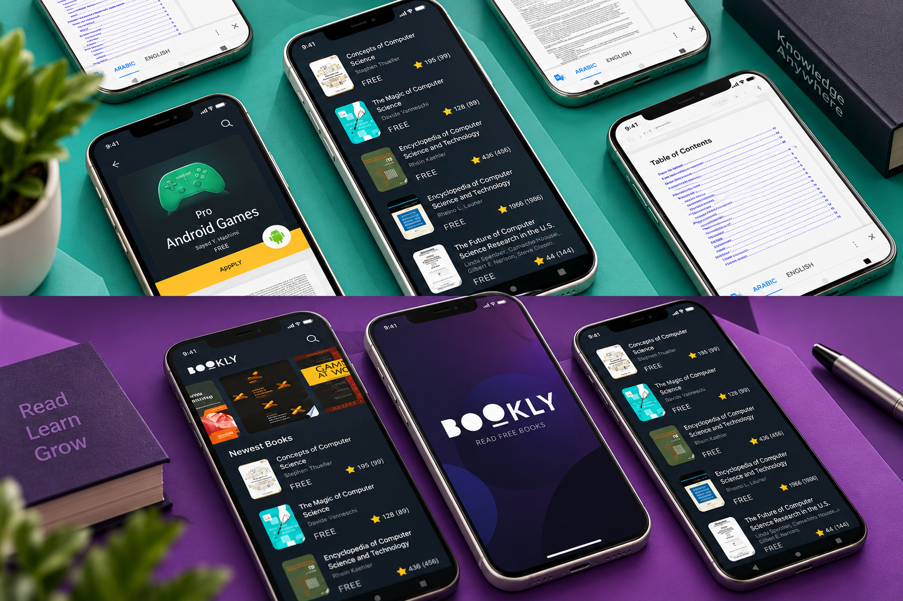

<div align="center">

# 📚 Books Library App

### Flutter • Dart • Book Discovery • Modern UI

A modern and beautifully designed **Books Library Application** developed using Flutter and Dart.

Explore books, discover new titles, browse book details, and enjoy a clean, intuitive mobile reading-library experience.


</div>

---

## 📸 Project Preview

<div align="center">

<a href="d9a1e70a-b43e-449a-81c9-34ac5a67a4ca.png">
  
</a>

</div>

---

## 📖 About the Project

**Books Library App** is a Flutter-based mobile application designed to provide an engaging interface for discovering and exploring books.

The project focuses on modern UI/UX design, book presentation, organized content, and smooth mobile navigation.

It demonstrates practical Flutter development skills through reusable widgets, structured layouts, and interactive book browsing.

---

## ✨ Key Features

### 📚 Book Discovery

- Explore a collection of books.
- Browse available book titles.
- View attractive book cover designs.
- Discover books through an organized interface.

### 📖 Book Details

- View individual book information.
- Explore book descriptions.
- Display book titles and authors.
- Present book covers and related information.

### 🔍 Book Browsing

- Navigate through book collections.
- Explore different book selections.
- Discover interesting titles.
- Enjoy a simple and intuitive browsing experience.

### 🎨 Modern UI/UX

- Clean and attractive Flutter interface.
- Responsive mobile layouts.
- Beautiful book cards.
- Smooth navigation.
- Consistent typography and spacing.
- Reusable Flutter widgets.

---

## 📱 Application Screens

The project is designed around the following user experience:

| Screen | Description |
|--------|-------------|
| Home Screen | Explore featured and available books |
| Books Collection | Browse book listings |
| Book Details | View information about a selected book |
| Navigation | Move between application sections |

---

## 🛠️ Technologies Used

| Technology | Purpose |
|------------|---------|
| Flutter | Cross-platform UI development |
| Dart | Application logic |
| Material Design | Interface components |
| Git | Version control |
| GitHub | Repository hosting |

---

## 🏗️ Application Overview

```text
            Books Library App
                    |
                    v
               Flutter UI
                    |
                    v
              Books Catalog
                    |
                    v
               Book Cards
                    |
                    v
             Book Selection
                    |
                    v
              Book Details
```

---

## 📂 Project Structure

A typical Flutter project structure:

```text
books_library_app/
│
├── lib/
│   ├── main.dart
│   ├── models/
│   ├── screens/
│   ├── widgets/
│   ├── services/
│   └── utils/
│
├── assets/
│   └── images/
│
├── android/
├── ios/
├── pubspec.yaml
└── README.md
```

The structure above is illustrative. Adjust it to match your actual source code.

---

## 🚀 Getting Started

### Prerequisites

Make sure you have:

- Flutter SDK
- Dart SDK
- Android Studio or VS Code
- Android emulator or physical device
- Git

### 1. Clone the Repository

```bash
git clone <YOUR_BOOKS_APP_REPOSITORY_URL>
```

Replace the placeholder with your actual GitHub repository URL.

### 2. Navigate to the Project

```bash
cd <YOUR_PROJECT_FOLDER>
```

### 3. Install Dependencies

```bash
flutter pub get
```

### 4. Run the Application

```bash
flutter run
```

---

## 💡 Development Highlights

This project demonstrates practical experience in:

- Flutter mobile application development.
- Dart programming.
- Building modern mobile interfaces.
- Creating reusable UI components.
- Presenting structured book information.
- Responsive layout design.
- Mobile application navigation.
- Organizing application screens.

---

## 🎯 Project Goals

- Build an attractive books library interface.
- Improve Flutter UI development skills.
- Create an intuitive book discovery experience.
- Practice reusable widget development.
- Organize book information in a user-friendly way.

---

## 🔮 Potential Future Improvements

- 🔍 Advanced book search.
- ❤️ Favorite books and personal reading lists.
- 📖 In-app book reading.
- 🔖 Bookmarks and reading progress.
- ⭐ Book ratings and reviews.
- 🌙 Light and dark themes.
- ☁️ Cloud synchronization.
- 📥 Offline book downloads.
- 🔔 Reading reminders.

---

## 👨‍💻 Developer

**Ahmed Jaber Ahmed**

Flutter Developer | Mobile App Developer

B.Sc. Computer Science & Artificial Intelligence

📍 Cairo, Egypt

- [GitHub](https://github.com/AhmedJaberAhmed)
- [Portfolio](https://ahmedjaberahmed.github.io/Jaber-website/)
- [LinkedIn](https://www.linkedin.com/in/ahmedjaberahmed/)

---

<div align="center">

### ⭐ Support the Project

If you find this project interesting, consider giving it a star!

**Built with Flutter 💙 and Dart 🎯**

</div>
